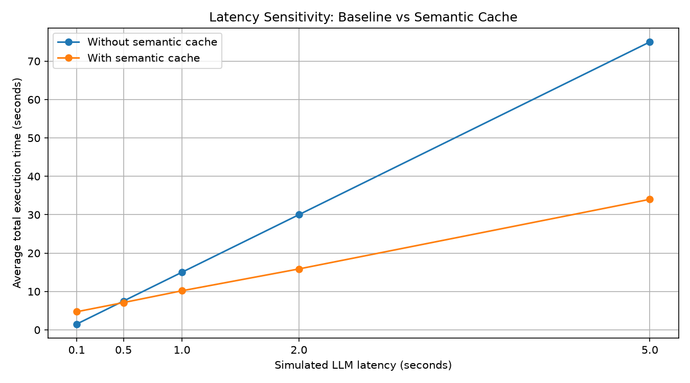
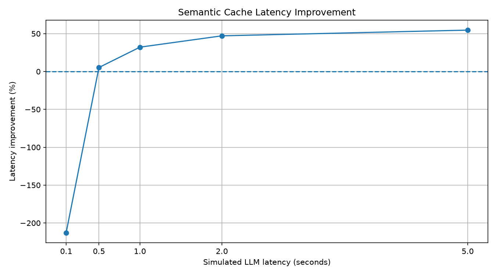

# LLM Semantic Cache

A lightweight semantic caching system that reduces repeated Large Language Model (LLM) requests by identifying semantically similar questions and reusing previously generated responses.

The project combines ONNX-based text embeddings, FAISS vector similarity search, and SQLite persistence to demonstrate how semantic caching can reduce unnecessary LLM calls, response latency, and estimated API costs.

> **Project scope:** This is an experimental prototype demonstrating semantic caching, vector similarity search, persistent storage, and benchmark evaluation. It is not a production-ready LLM caching service.

> **Important:** The current response generator is `MockLLM`, a simulated LLM. Performance and cost results are illustrative and are not measurements of a live LLM provider.

## Project Overview

Traditional caching relies on exact matches. However, users can ask the same question in different ways.

For example:

- "What is Docker?"
- "Explain Docker containers."
- "Can you describe what Docker does?"

A semantic cache converts questions into numerical embeddings and compares their similarity. When a sufficiently similar question already exists, the system retrieves its stored response instead of making another LLM request.

## Architecture

```text
              User Question
                    |
                    v
             Embedding Model
               (ONNX)
                    |
                    v
              FAISS Search
                    |
             Similarity Check
                    |
           +--------+--------+
           |                 |
        Cache HIT         Cache MISS
           |                 |
           v                 v
      Retrieve Answer    Mock LLM
           |                 |
           |                 v
           |             Generate Answer
           |                 |
           |                 v
           |             Store Result
           |             in SQLite
           |                 |
           +--------+--------+
                    |
                    v
              Return Answer
                    |
                    v
              Update Metrics
```

## Features

- Semantic similarity matching using ONNX embeddings.
- FAISS vector indexing and similarity search.
- SQLite storage for persistent cache records.
- Configurable similarity threshold.
- Automatic cache index reconstruction from stored records.
- Cache hit and miss tracking.
- Request latency measurement.
- Estimated LLM cost savings.
- Automated tests using pytest.
- Repeated benchmark experiments with CSV, JSON and chart reports.

## Technology Stack

| Technology | Version | Purpose |
|---|---:|---|
| Python | 3.14.7 | Core application |
| GPTCache | 0.1.44 | ONNX embedding integration |
| ONNX Runtime | 1.32.0 | Embedding inference |
| FAISS CPU | 1.16.0 | Vector similarity search |
| SQLite | Built-in | Persistent cache storage |
| NumPy | 2.5.5 | Numerical operations |
| Transformers | 4.57.3 | Model and tokenizer utilities |
| Hugging Face Hub | 0.36.0 | Model repository access |
| Matplotlib | 3.11.2 | Benchmark visualizations |
| Pytest | 9.2.0 | Automated testing |

**GPTCache maintenance:** GPTCache is an open-source semantic caching library maintained by Zilliz. Its GitHub repository shows continued development, although published package releases have lagged behind repository activity. This project pins GPTCache to version 0.1.44 for reproducibility.

## Project Structure

```text
llm-semantic-cache/
|-- app/
|   |-- __init__.py
|   |-- embeddings.py
|   |-- cache.py
|   |-- llm.py
|   |-- metrics.py
|   \-- main.py
|-- tests/
|   |-- __init__.py
|   |-- test_cache.py
|   \-- test_threshold_evaluation.py
|-- benchmarks/
|   |-- __init__.py
|   |-- benchmark.py
|   |-- evaluate_thresholds.py
|   |-- latency_sensitivity.py
|   \-- workload.json
|-- data/
|   \-- cache.db
|-- reports/
|   |-- benchmark_results.csv
|   |-- benchmark_summary.json
|   |-- benchmark_latency.png
|   |-- cache_performance.png
|   |-- threshold_evaluation.csv
|   |-- threshold_evaluation.json
|   |-- latency_sensitivity.csv
|   |-- latency_sensitivity.json
|   |-- latency_sensitivity.png
|   |-- latency_improvement.png
|   \-- previous_experiments/
|-- .gitignore
|-- requirements.txt
|-- README.md
\-- REPORT.md
```

The local SQLite database is generated by the application and is excluded from Git tracking.

## Installation

### 1. Clone the repository

```powershell
git clone https://github.com/pmman-sudo/llm-semantic-cache.git
cd llm-semantic-cache
```

### 2. Create a virtual environment

```powershell
python -m venv venv
```

### 3. Activate the environment

**Windows PowerShell:**

```powershell
.\venv\Scripts\Activate.ps1
```

**Windows Command Prompt:**

```cmd
venv\Scripts\activate.bat
```

**Linux and macOS:**

```bash
source venv/bin/activate
```

If PowerShell blocks script execution, run:

```powershell
Set-ExecutionPolicy -Scope Process -ExecutionPolicy Bypass
```

Then activate the environment again.

### 4. Install dependencies

```powershell
python -m pip install --upgrade pip
python -m pip install -r requirements.txt
```

The embedding integration may download its ONNX model during initial setup or first use. Internet access may be required for this initial model download.

## Running the Application

Start the interactive application:

```powershell
python -m app.main
```

Enter questions and observe whether the system reports a cache hit or miss.

The interactive application also supports:

- `metrics` - Display cache performance metrics.
- `exit` - Close the application.

The current response generator is a simulated LLM (`MockLLM`). It is designed to test the caching architecture without requiring an external LLM API key.

## Running Tests

Run the automated test suite:

```powershell
python -m pytest -v
```

The automated test suite contains 14 tests covering cache behavior and threshold evaluation.

- Cache storage and retrieval.
- Similar-question matching.
- Unrelated-question rejection.
- Persistence after restarting the cache.
- Invalid embedding dimensions.
- Zero-vector validation.
- Empty-question validation.
- Cache record counting.
- Topic classification for Docker, Kubernetes, Terraform, AWS, Python, and unrelated questions.

**Latest test result: 14 passed.**

## Running Benchmarks

Execute:

```powershell
python -m benchmarks.benchmark
```

The benchmark compares:

1. A baseline system that sends every question to the simulated LLM.
2. A semantic-cache system that checks FAISS and SQLite before generating a new response.

The current benchmark uses:

- 15 questions per trial.
- Five independent trials.
- A simulated LLM latency of one second.
- A fresh cache for each trial.
- A similarity threshold of 0.55.
- An illustrative assumed cost of $0.002 per LLM call.

The benchmark excludes embedding-model warm-up from measured cached request latency.

### Benchmark Results

Average results across five trials:

| Metric | Baseline | Semantic Cache |
|---|---:|---:|
| Average total latency | 15.0144 seconds | 9.7736 seconds |
| Median total latency | 15.0077 seconds | 9.7000 seconds |
| LLM calls per trial | 15 | 6 |
| Average latency per request | 1.001 seconds | 0.6516 seconds |

Additional results:

- Cache hits per trial: 9.
- Cache misses per trial: 6.
- Cache hit rate: 60%.
- Average time saved per trial: approximately 5.24 seconds.
- Average latency improvement: 34.9%.
- Estimated cost savings per trial: $0.018.

### Benchmark Visualizations

**Execution time comparison**


**Cache hits and misses**


### Interpreting the Results

The benchmark demonstrates that semantic caching can reduce LLM calls and improve latency when the cost of generating a new response is sufficiently high.

In an earlier experiment using a simulated LLM delay of 0.1 seconds, caching increased total execution time because embedding and retrieval overhead outweighed the time saved.

This illustrates an important engineering consideration: semantic caching is not automatically faster for every workload. Its effectiveness depends on factors such as LLM response latency, embedding overhead, cache hit rate, and workload characteristics.

The estimated cost savings are based on an assumed cost per request, not actual provider billing.


### Latency Sensitivity Evaluation

To understand how the simulated LLM response time affects cache performance, an additional experiment tests five latency settings.

Run the experiment with:

```powershell
python -m benchmarks.latency_sensitivity
```

**Methodology:**

- 15 questions per trial.
- Five independent trials at each latency setting.
- Simulated LLM delays of 0.1, 0.5, 1, 2 and 5 seconds.
- Similarity threshold of 0.55.
- Fresh SQLite cache for every trial.
- Embedding-model warm-up excluded from measurements.
- Simulated LLM cost assumption of $0.002 per call.

**Results:**

| Simulated LLM delay | Baseline (s) | Cached (s) | Latency improvement |
|---:|---:|---:|---:|
| 0.1 s | 1.5081 | 4.7171 | -212.79% |
| 0.5 s | 7.5085 | 7.1103 | 5.30% |
| 1.0 s | 15.0087 | 10.1842 | 32.14% |
| 2.0 s | 30.0071 | 15.8737 | 47.10% |
| 5.0 s | 75.0084 | 34.0093 | 54.66% |

The cache maintained a 60% hit rate across all five settings, with nine cache hits and six LLM calls per trial. Estimated cost savings were $0.018 per trial.

**Visualizations:**





**Interpretation:**

Semantic caching introduced substantial overhead when simulated LLM latency was only 0.1 seconds. At 0.5 seconds, the improvement was marginal. The benefit increased as simulated LLM latency increased, reaching 54.66% at five seconds.

These results illustrate the trade-off between embedding and retrieval overhead and the cost of generating a new response. They are controlled measurements using MockLLM, not production performance guarantees.

Detailed results are available in:

- `reports/latency_sensitivity.csv`
- `reports/latency_sensitivity.json`
- `reports/latency_sensitivity.png`
- `reports/latency_improvement.png`


## Threshold Evaluation

The similarity threshold determines how closely an incoming question must match a stored question before the cache returns a previous response. A lower threshold can increase cache hits but also increases the risk of retrieving an unrelated response. A higher threshold is more conservative but may reduce cache coverage.

To examine this trade-off, the project includes a threshold evaluation script:

```powershell
python -m benchmarks.evaluate_thresholds
```

### Evaluation Methodology

The evaluation uses:

- 15 reference questions covering Docker, Kubernetes, Terraform, AWS, and Python.
- 40 held-out evaluation questions.
- Six evaluation questions for each of the five main topics.
- Ten unrelated questions to test rejection of unrelated matches.
- Threshold values from 0.40 to 0.90, in increments of 0.05.

The evaluation classifies a retrieved result as correct when the stored question and incoming question belong to the same topic.

**Important:** This measures topic consistency, not factual answer correctness. Topic labels are assigned using keyword-based classification. The evaluation is a small synthetic experiment and does not establish production-level accuracy or generalization.

### Threshold Results

| Threshold | Correct-topic hits | Incorrect-topic hits | Misses | Precision | Coverage |
|---:|---:|---:|---:|---:|---:|
| 0.40 | 17 | 8 | 15 | 68.00% | 62.50% |
| 0.45 | 15 | 5 | 20 | 75.00% | 50.00% |
| 0.50 | 11 | 2 | 27 | 84.62% | 32.50% |
| 0.55 | 11 | 1 | 28 | 91.67% | 30.00% |
| 0.60 | 10 | 1 | 29 | 90.91% | 27.50% |
| 0.65 | 6 | 1 | 33 | 85.71% | 17.50% |
| 0.70 | 5 | 1 | 34 | 83.33% | 15.00% |
| 0.75 | 4 | 1 | 35 | 80.00% | 12.50% |
| 0.80 | 3 | 1 | 36 | 75.00% | 10.00% |
| 0.85 | 3 | 1 | 36 | 75.00% | 10.00% |
| 0.90 | 1 | 0 | 39 | 100.00% | 2.50% |

**Metric definitions:**

- Precision = correct-topic hits / all cache hits.
- Coverage = cache hits / total evaluation questions.

At the existing threshold of **0.55**, the evaluation produced 11 correct-topic hits, one incorrect-topic hit, and 28 misses. This corresponds to 91.67% observed topic precision and 30% coverage.

The 0.55 threshold is retained provisionally because it provides a useful balance between observed precision and cache coverage in this experiment. The 0.90 threshold achieved 100% observed precision but only one hit, which is insufficient evidence to recommend it.

The results are available in:

- `reports/threshold_evaluation.csv`
- `reports/threshold_evaluation.json`

The experiment can be reproduced using the command above.

## Limitations

- The current LLM implementation is simulated rather than connected to a production LLM API.
- The performance benchmark uses 15 synthetic questions, while the separate threshold evaluation uses 40 held-out synthetic questions and 15 reference questions.
- Similarity matching can return an inappropriate response if the threshold is too permissive.
- Performance results depend on the simulated LLM latency and local machine.
- The benchmark does not yet measure production concurrency or distributed cache behavior.
- Estimated cost savings are illustrative.

## Future Improvements

- Integrate a real LLM provider such as OpenAI.
- Add configurable similarity thresholds.
- Introduce cache expiration and invalidation.
- Add concurrent request handling.
- Implement cache monitoring and performance dashboards.
- Expand the benchmark with larger and more diverse workloads.
- Evaluate performance using real LLM response times and provider pricing.
- Containerize the application with Docker.
- Deploy the service to a cloud environment.

## Author

**Iyen Paul**

Cloud and DevOps Engineer | LLM Infrastructure | Python | AWS | Docker | Terraform

GitHub: https://github.com/pmman-sudo

---

*This project was developed as a practical exploration of semantic caching, vector search, persistent storage, and performance optimization for LLM-powered applications.*
