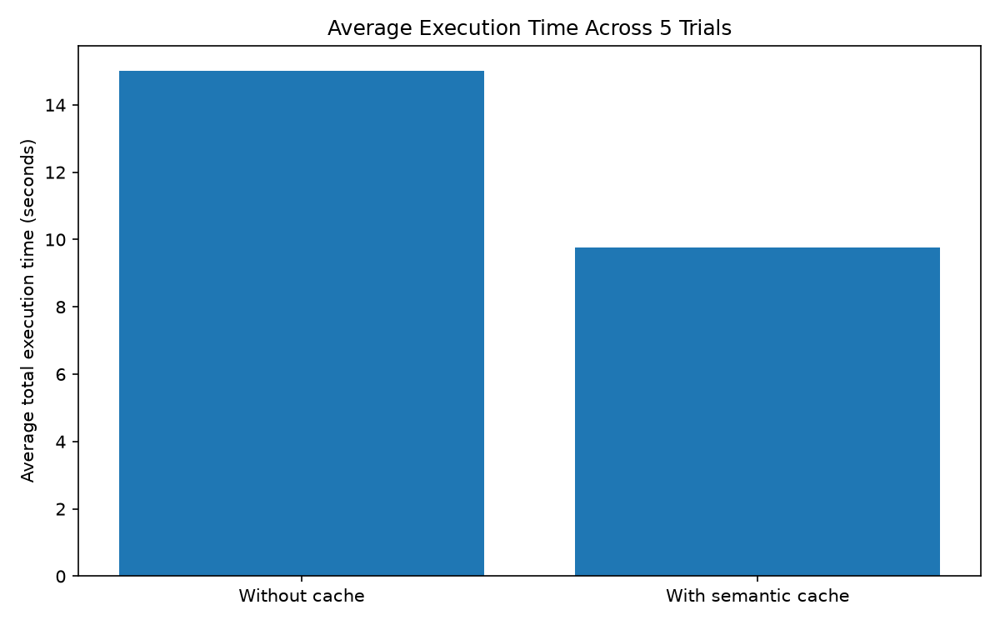
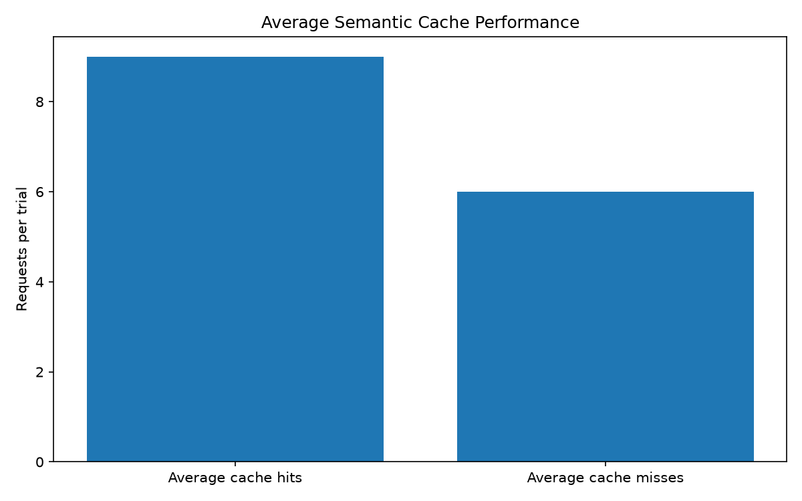

# LLM Semantic Cache

A lightweight semantic caching system that reduces repeated Large Language Model (LLM) requests by identifying semantically similar questions and reusing previously generated responses.

The project combines ONNX-based text embeddings, FAISS vector similarity search, and SQLite persistence to demonstrate how semantic caching can reduce unnecessary LLM calls, response latency, and estimated API costs.

## Project Overview

Traditional caching relies on exact matches. However, users can ask the same question in different ways.

For example:

- "What is Docker?"
- "Explain Docker containers."
- "Can you describe what Docker does?"

A semantic cache converts questions into numerical embeddings and compares their similarity. When a sufficiently similar question already exists, the system retrieves its stored response instead of making another LLM request.

## Architecture

```text
              User Question
                    |
                    v
             Embedding Model
               (ONNX)
                    |
                    v
              FAISS Search
                    |
             Similarity Check
                    |
           +--------+--------+
           |                 |
        Cache HIT         Cache MISS
           |                 |
           v                 v
      Retrieve Answer    Mock LLM
           |                 |
           |                 v
           |             Generate Answer
           |                 |
           |                 v
           |             Store Result
           |             in SQLite
           |                 |
           +--------+--------+
                    |
                    v
              Return Answer
                    |
                    v
              Update Metrics
```

## Features

- Semantic similarity matching using ONNX embeddings.
- FAISS vector indexing and similarity search.
- SQLite storage for persistent cache records.
- Configurable similarity threshold.
- Automatic cache index reconstruction from stored records.
- Cache hit and miss tracking.
- Request latency measurement.
- Estimated LLM cost savings.
- Automated tests using pytest.
- Repeated benchmark experiments with CSV, JSON and chart reports.

## Technology Stack

| Technology | Purpose |
|---|---|
| Python | Core application |
| ONNX Runtime | Embedding inference |
| GPTCache ONNX embedding integration | Text embedding generation |
| FAISS | Vector similarity search |
| SQLite | Persistent cache storage |
| NumPy | Numerical operations |
| Matplotlib | Benchmark visualizations |
| Pytest | Automated testing |

## Project Structure

```text
llm-semantic-cache/
│
├── app/
│   ├── __init__.py
│   ├── embeddings.py
│   ├── cache.py
│   ├── llm.py
│   ├── metrics.py
│   └── main.py
│
├── tests/
│   ├── __init__.py
│   └── test_cache.py
│
├── benchmarks/
│   ├── __init__.py
│   ├── benchmark.py
│   └── workload.json
│
├── data/
│   └── cache.db
│
├── reports/
│   ├── benchmark_results.csv
│   ├── benchmark_summary.json
│   ├── benchmark_latency.png
│   ├── cache_performance.png
│   └── previous_experiments/
│
├── .gitignore
├── requirements.txt
├── README.md
└── REPORT.md
```

The local SQLite database is generated by the application and is excluded from Git tracking.

## Installation

### 1. Clone the repository

```powershell
git clone https://github.com/YOUR_USERNAME/llm-semantic-cache.git
cd llm-semantic-cache
```

Replace `YOUR_USERNAME` with your GitHub username.

### 2. Create a virtual environment

```powershell
python -m venv venv
```

### 3. Activate the environment

```powershell
.\venv\Scripts\Activate.ps1
```

### 4. Install dependencies

```powershell
python -m pip install --upgrade pip
pip install -r requirements.txt
```

The embedding integration may download its ONNX model during initial setup or first use. Internet access may be required for this initial model download.

## Running the Application

Start the interactive application:

```powershell
python -m app.main
```

Enter questions and observe whether the system reports a cache hit or miss.

The interactive application also supports:

- `metrics` — display cache performance metrics.
- `exit` — close the application.

The current response generator is a simulated LLM (`MockLLM`). It is designed to test the caching architecture without requiring an external LLM API key.

## Running Tests

Run the automated test suite:

```powershell
python -m pytest -v
```

The initial test suite contains eight tests covering:

- Cache storage and retrieval.
- Similar-question matching.
- Unrelated-question rejection.
- Persistence after restarting the cache.
- Invalid embedding dimensions.
- Zero-vector validation.
- Empty-question validation.
- Cache record counting.

**Initial test result: 8 passed.**

## Running Benchmarks

Execute:

```powershell
python -m benchmarks.benchmark
```

The benchmark compares:

1. A baseline system that sends every question to the simulated LLM.
2. A semantic-cache system that checks FAISS and SQLite before generating a new response.

The current benchmark uses:

- 15 questions per trial.
- Five independent trials.
- A simulated LLM latency of one second.
- A fresh cache for each trial.
- A similarity threshold of 0.55.
- An illustrative assumed cost of $0.002 per LLM call.

The benchmark excludes embedding-model warm-up from measured cached request latency.

### Benchmark Results

Average results across five trials:

| Metric | Baseline | Semantic Cache |
|---|---:|---:|
| Average total latency | 15.0144 seconds | 9.7736 seconds |
| Median total latency | 15.0077 seconds | 9.7000 seconds |
| LLM calls per trial | 15 | 6 |
| Average latency per request | 1.001 seconds | 0.6516 seconds |

Additional results:

- Cache hits per trial: 9.
- Cache misses per trial: 6.
- Cache hit rate: 60%.
- Average time saved per trial: approximately 5.24 seconds.
- Average latency improvement: 34.9%.
- Estimated cost savings per trial: $0.018.

### Benchmark Visualizations

**Execution time comparison**



**Cache hits and misses**



### Interpreting the Results

The benchmark demonstrates that semantic caching can reduce LLM calls and improve latency when the cost of generating a new response is sufficiently high.

In an earlier experiment using a simulated LLM delay of 0.1 seconds, caching increased total execution time because embedding and retrieval overhead outweighed the time saved.

This illustrates an important engineering consideration: semantic caching is not automatically faster for every workload. Its effectiveness depends on factors such as LLM response latency, embedding overhead, cache hit rate, and workload characteristics.

The estimated cost savings are based on an assumed cost per request, not actual provider billing.

## Limitations

- The current LLM implementation is simulated rather than connected to a production LLM API.
- The benchmark uses a small synthetic workload of 15 questions.
- Similarity matching can return an inappropriate response if the threshold is too permissive.
- Performance results depend on the simulated LLM latency and local machine.
- The benchmark does not yet measure production concurrency or distributed cache behavior.
- Estimated cost savings are illustrative.

## Future Improvements

- Integrate a real LLM provider such as OpenAI.
- Add configurable similarity thresholds.
- Introduce cache expiration and invalidation.
- Add concurrent request handling.
- Implement cache monitoring and performance dashboards.
- Expand the benchmark with larger and more diverse workloads.
- Evaluate performance using real LLM response times and provider pricing.
- Containerize the application with Docker.
- Deploy the service to a cloud environment.

## Author

**Iyen Paul**

Cloud and DevOps Engineer | LLM Infrastructure | Python | AWS | Docker | Terraform

GitHub: https://github.com/pmman-sudo

---

*This project was developed as a practical exploration of semantic caching, vector search, persistent storage, and performance optimization for LLM-powered applications.*